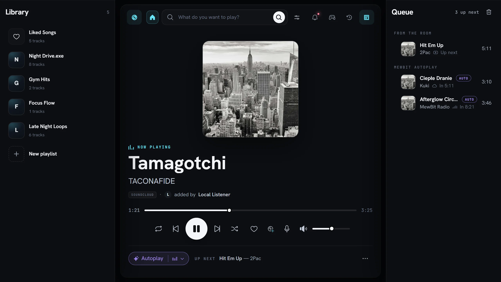
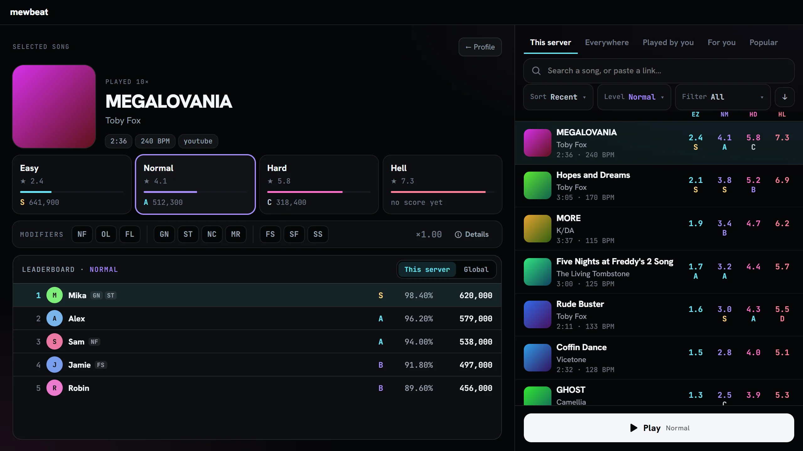
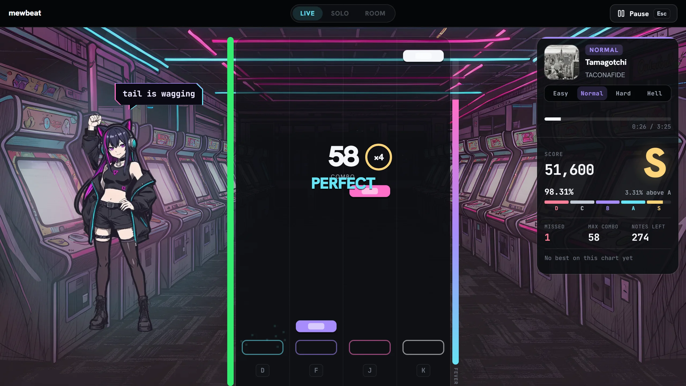
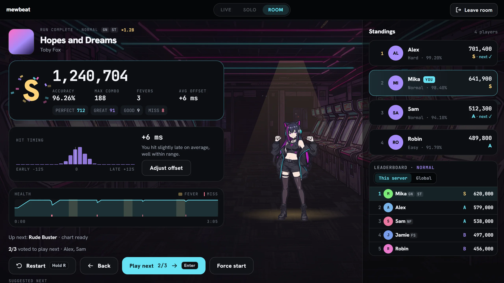

# MewBit

**A self-hosted Discord music bot with a shared player that opens inside the voice channel.**

Multi-source search across Deezer, Spotify, SoundCloud and YouTube. FLAC playback, DJ
controls, a fifteen-band equalizer, synced lyrics and playlists — on your own hardware, with
no tier that takes any of it away.

Three surfaces, one state: a **Discord Activity** everyone in the channel shares, a **player
embed** in the text channel for people who do not open it, and a **web dashboard** for the
people who run the server.

> **Keep secrets out of Git.** Start from [`.env-example`](.env-example) and keep your real
> `.env*` files on the machine that runs the bot. Tokens, cookies, API keys and the Discord
> client secret never belong in a commit.

---

## What it does

**Playback.** Lavalink v4 in a voice channel, with Deezer, Spotify, SoundCloud and YouTube
searched together and direct provider URLs accepted. FLAC through Deezer. Cross-provider
loudness compensation, a configurable default source per server or per user, and recovery
snapshots that survive an unexpected disconnect — restored when someone starts playback
again, never by silently rejoining a channel the bot was removed from.

**Autoplay.** An optional AI DJ plans the next transitions, and every proposal is verified
against a real, playable provider entry before it can be queued. Behind it, the V3 selector
scores a small trusted pool on musical fit — artist relation, album, similarity, session
memory — rather than provider order, and caps same-artist and same-album runs so one act
cannot take over the room. Autoplay picks stay marked in the queue.

**The Activity.** A shared visual player in the voice channel: the same queue, artwork and
transport for everyone, with search, playlists, synced lyrics, thirteen effects and the
equalizer. There is no host who sees more than the rest.

**mewbeat.** A four-key rhythm game inside the Activity. Any song — the one playing in voice,
or one you search for or paste — is analysed on your own hardware and turned into four
levels, Easy to Hell, each with its own leaderboard. Play along with the bot (Live), alone
(Solo) or with the room (Room), with modifiers, a profile, ranking and rooms with a shared
queue. The charts are generated, not hand-made, so not every map is perfect. Guide:
[mewbeat](docs/mewbeat.md).

**Running a server.** DJ roles and vote-to-skip, player and announcement channels, per-server
logging, tickets, moderation commands, custom embeds, health metrics and listening
statistics — configurable from Discord or from the dashboard.

|  |  |
| :-- | :-- |
| The Activity's player | mewbeat: picking a song and a level |

|  |  |
| :-- | :-- |
| mewbeat: a run | mewbeat: results in a room |

The screenshots come from the Activity's mock mode: made-up songs and players, no Discord.

## Commands

Every command is documented by the running instance itself, so the list is never a stale
copy:

- **In Discord** — `/help` browses all 78 commands by category.
- **On the web** — the **Commands** page of your deployment's site, with search across every
  category. It reads the same source `/help` does.

## Requirements

- Node.js **20 or newer**
- pnpm **10 or newer**
- Docker and Docker Compose (recommended for Lavalink and production)
- A Discord application and bot token
- A Discord server where you can manage the bot and slash commands

For the full experience, configure at least YouTube credentials and a Last.fm API key.
Spotify, Deezer, Genius and SoundCloud access are optional but improve provider coverage and
metadata.

## Quick start

```bash
pnpm install
pnpm --dir activity install
```

Copy the example environment and fill in the required values. For a local Lavalink container,
keep `LAVALINK_HOST=127.0.0.1`.

```bash
cp .env-example .env.dev
```

On PowerShell: `Copy-Item .env-example .env.dev`

```bash
pnpm lavalink:dev    # start Lavalink
pnpm deploy:dev      # register slash commands
pnpm start:dev       # start the bot
```

The bot is ready when it logs in to Discord and connects to Lavalink. Join a voice channel and
run `/play`. Re-run `pnpm deploy:dev` whenever a slash command's name, options or description
change.

Which values are required, and what every optional one does, is in
[Configuration](docs/configuration.md).

## Guides

| Guide | What is in it |
| --- | --- |
| [Configuration](docs/configuration.md) | Every environment variable, what it changes, and what happens when it is unset. |
| [Discord setup](docs/discord-setup.md) | Creating the application, first-server setup, and putting the Activity live. |
| [Dashboard setup](docs/dashboard-setup.md) | The web surface: OAuth, access control, what it can change, and request hardening. |
| [Music, queue and autoplay](docs/music.md) | How search ranks, how the queue orders itself, and how autoplay decides. |
| [mewbeat](docs/mewbeat.md) | The rhythm game in the Activity: how to play, and how a chart is made, stored and run. |
| [Deployment](docs/deployment.md) | Docker Compose, the Raspberry Pi / ARM image, and updating safely. |
| [Testing and diagnostics](docs/troubleshooting.md) | The test suite, the autoplay soak runner, runtime checks and common failures. |
| [Project layout](docs/project-layout.md) | Where things live, and the provider responsibility that comes with running this. |
| [Design system](DESIGN.md) | The palette, type, layout and component rules the web surfaces are built from. |

## Running it for real

```bash
docker compose up -d --build
```

The stack brings up the bot, a Lavalink node, a private `yt-cipher` service and the mewbeat
melody decoder together, and persists bot data in `helpers/data` and file logs in `logs` —
back both up before rebuilding a host. The full sequence, including the pinned YouTube source patch, is in
[Deployment](docs/deployment.md).

## Licence

**Educational & Research Licence.** MewBit is provided as an educational example and proof of
concept. It is licensed for learning, research and private testing — **not** for public Discord
servers, commercial use, or distribution as a service. See [LICENSE](LICENSE) for the full
terms.

MewBit resolves audio through third-party services whose terms it may conflict with. The author
does not endorse violating any service's terms, and anyone running an instance is solely
responsible for their own compliance. The software is provided "as is", without warranty of any
kind.

Not affiliated with or endorsed by Discord, Deezer, Spotify, SoundCloud or YouTube. All
trademarks and cover artwork belong to their respective owners.
