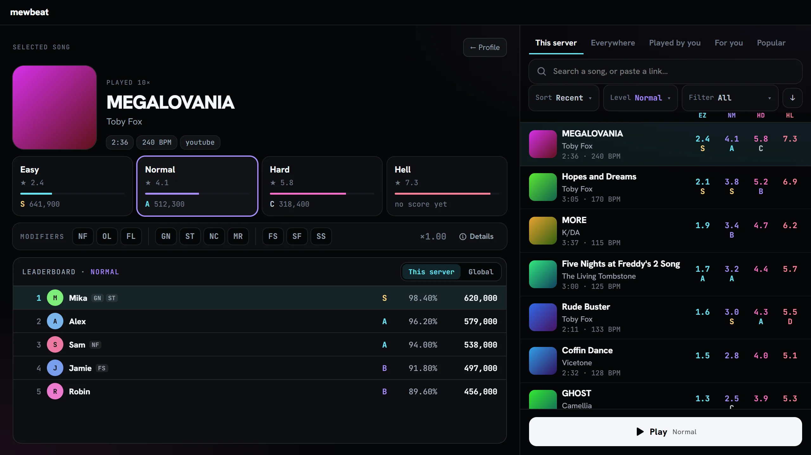
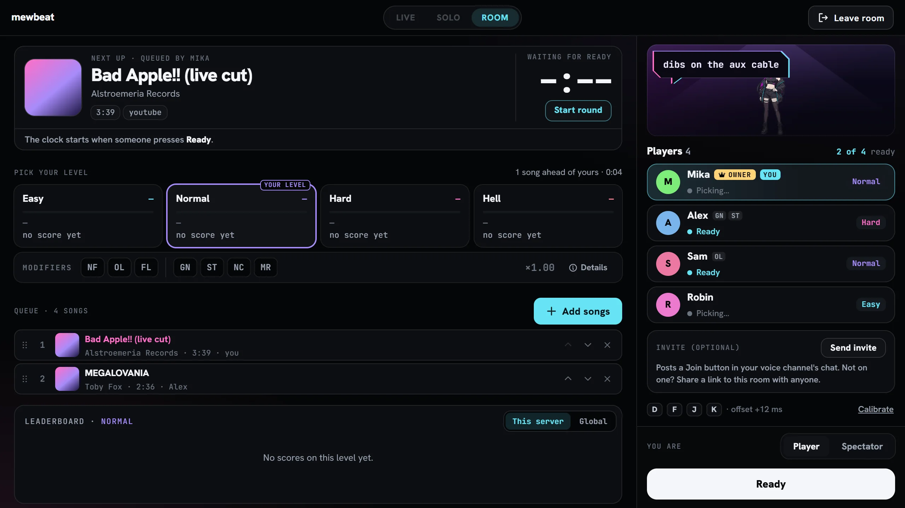
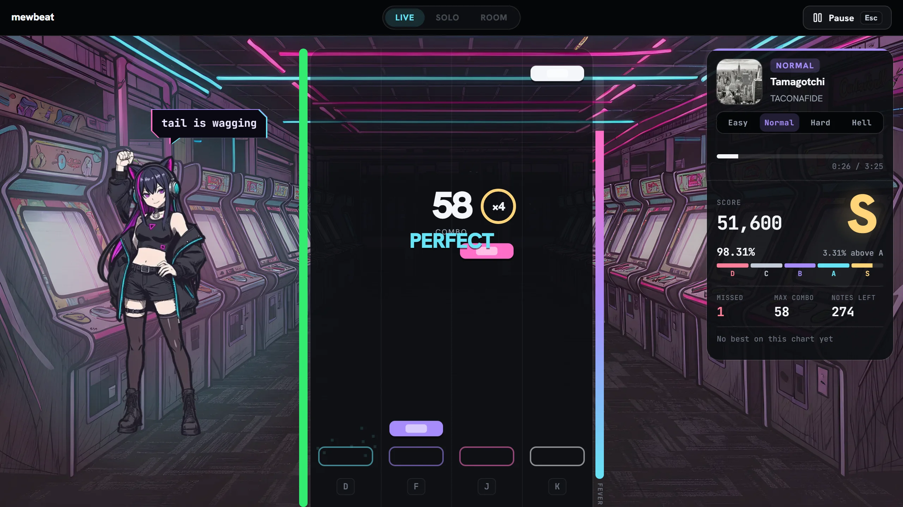
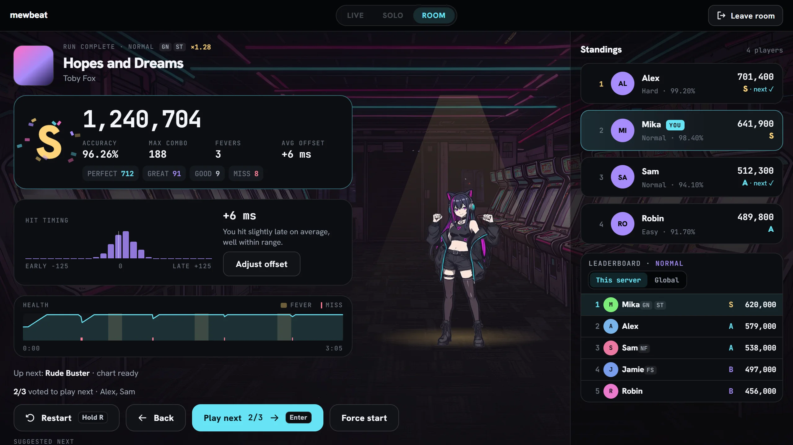
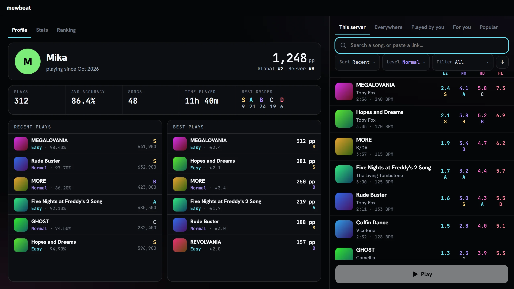
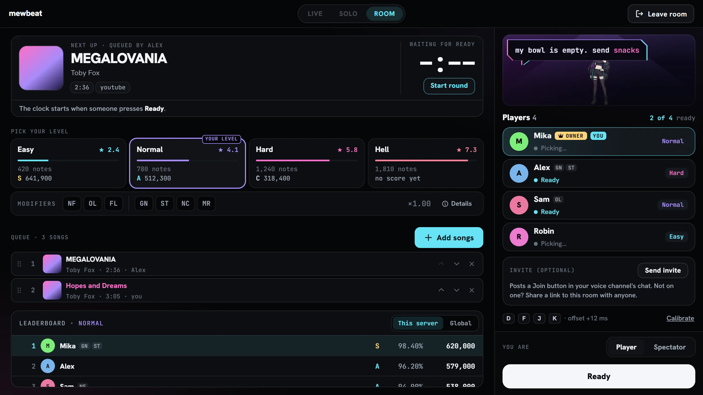
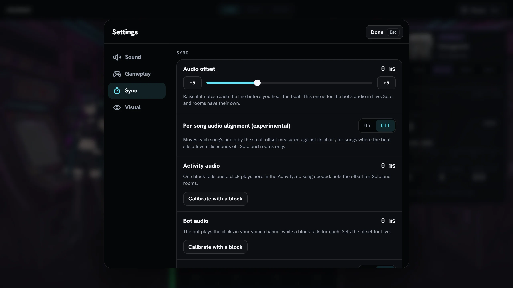
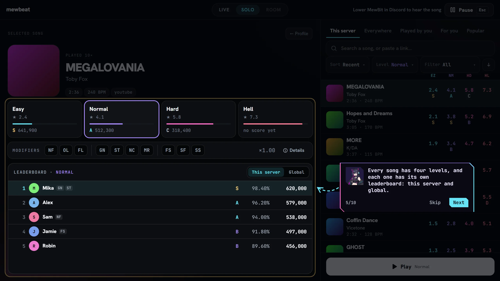
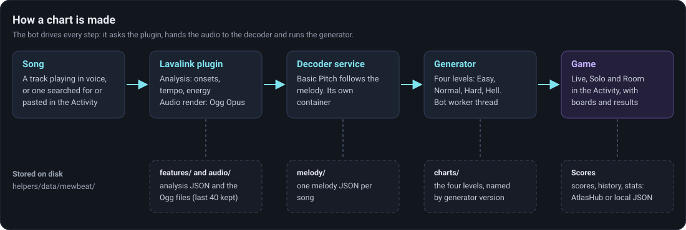

<!-- Split out of README.md. -->

[← Back to the README](../README.md)

# mewbeat

mewbeat is a four-key rhythm game inside the Discord Activity. Pick a song, press **D F J K** as the notes fall onto the line, and see your score on a leaderboard. It works on any song MewBit can play: the one in the voice channel, or one you search for or paste a link to.

The notes are **generated, not hand-made**. MewBit listens to the song, finds the beat, the loud moments and the melody, and writes four levels from that. Many maps feel right, some do not, and none has been checked by a person. The game has a "report a bad map" button for exactly that reason.



The first half of this page is for people playing. The second half, from [For operators](#for-operators), is for whoever runs the bot.

## For players

### Opening it

The game needs a physical keyboard, so it is there only on the **desktop Discord client**. Open the Activity and press the gamepad button in the header. The first time, MewBit's mascot, Mewbit, walks you through the game (see [The first-run tour](#the-first-run-tour)). If you were sent an invite link to a room, the game opens by itself and skips the tour. In a DM with the bot there is no music player: the game opens by itself, and a "Play mewbeat" button brings it back after you close it.

### The three modes

The mode switch is at the top of the game.

| Mode | Where the music comes from | What it is for |
| --- | --- | --- |
| **Live** | The bot plays the song in the voice channel, as it always does. You play along to it with what you hear in Discord. | Playing along with whatever the room is listening to. You cannot pause: the song is not yours to stop. A live board shows everyone on the channel playing the same song. Live is greyed out when the bot is not playing anything. |
| **Solo** | The Activity plays the song itself, on your machine. | Playing what you want, when you want. There is a short count-in, and you can pause from the menu. You can also change the song speed (see [Modifiers](#modifiers)). |
| **Room** | The Activity plays the song, in sync for everyone in the room. | A round with other people on one shared queue. See [Rooms](#rooms). |

Solo and Room play the song in the Activity, so turn MewBit down in Discord if the bot is also playing, or you hear it twice. The game shows a hint when that is the case.

If you shrink or pop out the Activity window, the game shows a small tile instead, and a Solo run pauses by itself.

### Picking a song

Song select has the song's details on the left, with the four levels as tiles, the modifiers and a leaderboard, and the list of songs on the right.

The list has five tabs:

- **This server**: songs played on this Discord server, charted or not.
- **Everywhere**: songs played on any server this bot is in.
- **Played by you**: your own history.
- **For you**: songs like the ones you play, and ones worth another go. It draws on songs similar to yours (that part needs the bot to have a Last.fm key), songs you could play again, and songs from this server. A new player with no plays gets the Popular list instead. It has a Refresh button.
- **Popular**: well-known songs from rhythm games, picked from community-map favourites in osu!, Beat Saber, Quaver, Geometry Dash, Clone Hero and Friday Night Funkin' mods.

The For you and Popular lists only suggest songs; nothing is charted until you pick one.

The search box takes a song name, or a pasted link. It starts searching after two characters. You can sort the list (recent, stars, BPM, length, plays, title), filter it to played or not-yet-played songs, and sort or filter by one level. Each row shows the stars of all four levels (EZ, NM, HD, HL). A preview of about 30 seconds plays when you pick a row.

Select a song, pick a level tile, then press **Play**.

### A song that has no chart yet

The first time a song is picked it has no chart, and the row says so. Press **Chart this map**. The game then shows a "Charting…" state with a step in plain words (listening to the song, following the melody, writing the notes) and, when other songs are queued, a line like "2 songs ahead of yours" with the time elapsed. When it is done, the levels appear and you can play. A song that plays in the voice channel is also charted in the background while it plays, so it is often ready before you ask.

Charting takes time that depends on the hardware and on how many songs are waiting; on a quick PC it was about 15 seconds (see [Measured speed](#measured-speed)). The game checks again every 4 seconds, for up to 5 minutes. Some songs are refused, and the row says why:

- you already have 3 songs being charted;
- the queue is full: try again in a moment;
- the song is over 20 minutes long;
- it is a live stream;
- charting failed: press **Try again**.



### The four levels and the stars

Every song gets four levels: **Easy**, **Normal**, **Hard** and **Hell**, from sparse to dense. Each level has its own leaderboard.

The **stars** are a rough measure of how hard a chart is to play: the number of notes in its busiest 8 seconds counts most, then how many of the notes are chords, then how many are holds, up to a ceiling of 10. They are not a promise: a chart with few stars can still be awkward.

The tile also shows your best grade on that level, and one level is marked **Suggested**: the one the game starts you on.

### How a run works

Notes fall down four lanes toward the line at the bottom. Press the lane's key when a note reaches it: **D F J K**, left to right. You can rebind them in Settings.

- **Judgements.** How far from the exact moment you were decides it: within 50 ms is **Perfect**, 90 ms **Great**, 125 ms **Good**; a press up to 150 ms early on a note counts as a miss, so mashing ahead of the notes costs you. Late by more than the Good window is a miss.
- **Points.** A Perfect is worth 300, a Great 200, a Good 100. Your points are multiplied by your combo: x2 from a combo of 10, up to x4 from 30. A miss breaks the combo.
- **Holds.** A long note has a head and a tail. Press on the head and keep the key down until the tail. Releasing early, or not pressing, is a miss. The tail is judged with windows 1.5 times wider.
- **FEVER.** Hits fill a bar and misses take a little from it. When it is full, press **Space** to start a FEVER: 8 seconds of double points. You can switch the setting to start it automatically.
- **Health.** The bar starts at half. Perfects and Greats add a little, Goods less, and a miss takes a lot (a missed hold tail half as much). If it empties, the run fails, unless you picked No Fail. With One Life or Four Lives it is the count of misses that ends the run, not the bar.
- **Grades.** From your accuracy: **S** 95% and up, **A** 90, **B** 80, **C** 70, **D** below. Accuracy counts Perfect as 100, Great 80, Good 50 and a miss 0.

Esc opens the menu (resume, restart, level, settings, report a bug, leave). Hold **R** to restart the song.



### Modifiers

Modifiers change a run and its score. The score is multiplied by 1 plus the sum of the modifiers' bonuses (never below 0), and your results show the multiplier. Speed modifiers work in Solo only, and only one of "fail" and "speed" modifiers can be on at a time.

| Modifier | Score bonus | Effect |
| --- | --- | --- |
| No Fail | none | Health can empty without ending the run, but points halve once it has. |
| One Life | +10% | The first miss ends the run. |
| Four Lives | +4% | Four misses end the run. |
| Ghost Notes | +16% | Notes fade out before they reach the line. |
| Strict Timing | +12% | Every timing window is a quarter smaller. |
| No Colors | +6% | Every note is the same colour. |
| Mirror | +2% | Lanes are flipped left to right. |
| Faster Song | +15% | 1.2 times the speed. Solo only. |
| Super Fast | +30% | 1.5 times the speed. Solo only. |
| Slower Song | -40% | 0.85 times the speed. Solo only. |

Runs with different modifiers share a leaderboard; the multiplier is what makes them comparable.

### Results

When the song ends you get a results screen: the grade, your score (marked **NEW BEST** when it is one), accuracy, max combo, how many FEVERs you had, your average timing offset, a histogram of how early or late your hits were, and a graph of your health through the song. Under it is a suggested next song, and in Live and Room an **Up next** line with the song that follows. From here you can restart or go back to song select.

The histogram has an **Adjust offset** button. If it leans one way, your audio offset is probably off; see [Settings](#settings-worth-knowing).

Not every run counts for the leaderboard. When one does not, the results say why:

- "Autoplay runs aren't ranked."
- "The difficulty changed during the run."
- "Part of the song was skipped."
- "Too little of the song was played to rank."
- "Calibration run", for a run used to calibrate (see below).

The rules are checked by the bot, not trusted from the game: it replays your judgements through the same scoring code, and ranks the run only if you were not in a calibration, did not fail, did not use autoplay, did not change level, started within 2 seconds of the first note, and judged at least half of the chart. A run that is not ranked is still shown, and still goes in your history.



### Your profile, stats, rating and leaderboards

The left pane of song select has three tabs, **Profile**, **Stats** and **Ranking**.

- **Profile**: your rating and rank, plays, average accuracy, songs and time played, your best grades, and your recent and best plays.
- **Stats**: key presses (and how many hit empty air), holds held, best combo, full combos, FEVERs, a timing graph, and your best combo on each map. Only runs that got through at least half the song are counted.
- **Ranking**: the players with the highest rating, with their accuracy. Switch between this server and global. Pick a player to open their profile and stats.

Your **rating** is built from your best plays, one per song and level, on the chart version now in use. Each play counts for more with more stars and with better accuracy: roughly 8 x stars^2.2 x accuracy share^2.5, where the share is accuracy over 50%, scaled to 0 to 1 (so 50% accuracy or below counts for nothing). Your plays are sorted best first, and each one weighs 0.95 times the one before it, so your top few plays matter most and a new, hard song can lift it. An unfinished run is rated on its accuracy times how much of the song you played.

Each song and level has **leaderboards**, under the song's details: **This server** and **Global**. Your best score is kept per board. Boards are separate for each version of the generator and of the scoring rules, so a chart that was regenerated starts a fresh board.



### Rooms

A room is a lobby on one Discord server, with a shared song queue. There is one room per server (one per DM instance, for a DM). A room holds up to 10 players, with more people able to spectate (up to 50 in all), 20 songs in the queue and 5 songs per person. Rooms live in memory: a bot restart closes them.

In the lobby you can:

- pick your level, in **Pick your level**;
- add songs to the queue with **Add songs**, move them or remove them;
- see who is in, and set **You are** to Player or Spectator;
- press **Send invite** (below);
- check your key chips and your offset, and **Calibrate** it;
- press **Ready**.



How a round starts:

1. The first round waits up to 60 seconds for people to press **Ready**. When everyone is ready, that shortens to 5 seconds.
2. Everyone's game loads the song (up to 20 seconds, or 120 if the song may still be charting), and the round starts together.
3. The round ends when everyone who loaded the song has finished it, or 10 seconds after the song would have ended at the latest. Then come the results, with everyone's standings.

After a round, being ready is a vote for the next song: the results screen calls it **Play next**, the lobby still calls it **Ready**. When more than half of the players have voted, a 5-second countdown starts the next song. The host has a start button of their own (**Start round** before the first round, **Force start** while a vote is open, **Start now** during a countdown): the first press begins the countdown, the second skips what is left of it. Spectators do not count towards a vote.

If you leave in the middle of a round, the game warns you that your score will not count. If you join while a round is running, you spectate until the next one.

The **Send invite** button posts a message with a **Join the room** button into the text chat of your voice channel, once a minute per server at most. Anyone who presses it opens the Activity and lands in the room. If you are not in a voice channel, the button opens Discord's own share window with a link, which works for 6 hours.

### Settings worth knowing

Open them from the menu with Esc. They are saved to your Discord account, not the machine. The groups are Sound, Gameplay, Sync and Visual.

- **Keys**: rebind the four lane keys (D F J K by default). Space starts FEVER.
- **Scroll speed**: 1 to 10, default 5. By tempo (the speed follows the song's pace) or Fixed.
- **FEVER**: manual (Space) or automatic.
- **Music volume**: for Solo and Rooms only. In Live the music is the bot's, and Discord's volume controls it.
- **Even out loudness**: on by default. Brings songs to a similar volume.
- **Hit sounds**: a click per hit, with a choice of sound and a volume, off by default.
- **Effects**: Full, Reduced or Off, for slower machines. **Show Mewbit** hides the mascot.



**Sync** is the part that matters most, because every setup has a little delay of its own:

- **Audio offset** moves the notes against the music, from -300 ms to +700 ms in 5 ms steps. There are two, kept separately: one for Live (the bot's audio, through Discord) and one for Solo and Rooms (the Activity's own audio).
- **Calibrate with a block** (under "Activity audio" and "Bot audio"): one block falls and a click sounds, and you press when you hear the click. For "Activity audio" the Activity plays the click and the result sets your Solo and Room offset. For "Bot audio" the bot plays a click in the voice channel for each block, and the result sets your Live offset.
- **Calibrate from taps**: tap along to a song; after 16 taps it suggests an offset (the median of the last 64, rounded to 5 ms) that you can **Apply**, **Reset taps**, or let an **Auto offset** switch keep up to date.
- **Per-song audio alignment (experimental)**: off by default. A few songs' audio is shifted a little against their chart (in steps of 20 ms). When it is on, the game measures this per song and moves the audio to match. It only applies to Solo and Rooms, and it is experimental: turn it on only if a song feels consistently early or late.

**Replay tutorial** is in the Visual group (not while you are in a room).

### The first-run tour

The first time you open the game, Mewbit shows you around in ten short steps: the welcome, Solo, the song list, charting, the levels, Live, rooms and the lobby. It then asks whether you want the controls explained, and ends with a joke: a ridiculously hard Hell chart plays for a few seconds, Mewbit cuts it off, and a calm song starts as a real run. The tour runs in a sample session and sends nothing, and you can leave it any time or replay it from Settings. After your first played map a second, short part runs: a word about Hell being very hard, that every map is written by a generator and not every map is perfect, the modifiers, that search takes links, and how to report a map.



### Reporting a bad map or a bug

Open the menu with Esc and press **Report a bug**. Choose **Bug**, **Map** or **Idea**, write 10 to 1000 characters, and send. For a Map report you pick the run it is about, from your recent plays, so the author can open exactly that chart. You can send one report a minute. The report goes to a private channel of the person running the bot; it is turned off when they have not set one up.

The `/report` command does the same for a bug or an idea, from any channel or DM.

## For operators

### How a chart is made



For each song the bot does the following, in order, and stores every step so it is done once per song.

1. **Analysis (Lavalink plugin).** The bot asks the mewbeat plugin, running inside Lavalink, to analyse the track. The plugin decodes the audio and returns features: where the notes start (onsets), the tempo and the energy over time. It does one analysis at a time and refuses tracks over 20 minutes and live streams.
2. **Audio render (the same plugin).** It also renders the track as Ogg Opus, which the Activity plays in Solo and Room. The bot keeps the last 40 of these.
3. **Melody (decoder service).** The audio goes to the decoder service, which runs Basic Pitch (an open neural network for finding notes) and returns the song's melody. It is a separate container because it is Python. Tracks over 20 minutes, or under 2 seconds, are skipped.
4. **Chart (generator).** The generator, in a worker thread of the bot, combines the analysis and the melody into four levels. If the melody has not arrived after 120 seconds, the charts are made without it (they are marked as made without a melody), and the melody is retried later.
5. **Serving.** The Activity asks the bot for the chart and for the audio; Live also uses the bot's own playback position.

The decoder is optional in the sense that charts are still made when it is down, but they lose most of what follows the melody.

The generator has a version number, kept in the file names of stored charts. When a new version ships, charts are rewritten on demand, and old leaderboards stay under the old version.

#### Measured speed

On a development PC (x86, Docker Desktop, the Compose stack at commit 78f53f2), a song that had not been seen before, 1:56 long, was charted in about 14 seconds from first request: about 4.7 s of plugin analysis, 7.9 s of audio render and 2.8 s of decoder time. Treat it as one data point, not a guarantee. The numbers on other hardware, including a Raspberry Pi, are not measured.

### What is stored where

Everything the game keeps is under `helpers/data/mewbeat/`, inside the data folder Compose already persists (back it up with the rest of `helpers/data`).

| Path | What is in it | Kept |
| --- | --- | --- |
| `features/` | The plugin's analysis of each song, as JSON. | Until deleted. A failure is not retried for 10 minutes, a busy plugin for 30 seconds. |
| `audio/` | The rendered Ogg files. | The most recent 40; older ones are removed. |
| `melody/` | The decoder's melody for each song, as JSON. | Until deleted. A failed decode is retried after 10 and then 30 minutes, then left. |
| `charts/` | The four levels of each song. File names carry the generator version. | Until deleted. |
| `offset/` | The per-song audio offsets for the experimental alignment setting. | Until deleted. |
| `scores.json`, `history.json`, `stats.json` | Leaderboards, every non-calibration run, and player stats. | Used when AtlasHub is not set up. |
| `atlashub-outbox.jsonl` | The journal of changes not yet sent to AtlasHub. | Until sent. |

Players' game settings are stored with their other Activity settings, per Discord user.

**AtlasHub** is an optional place for the scores, history and stats, a REST API over Postgres. With `ATLASHUB_URL` and `ATLASHUB_SECRET_KEY` set, every change is written to the journal first and sent in the background, so a slow or unreachable AtlasHub does not stall the game and nothing is lost when it comes back. Without them everything stays in the JSON files above.

A song is identified by where it comes from, its id there and its length (for example a YouTube video id and its duration), not by its title. The same video reached through two different links has one chart and one board; the same song from another source, or another upload of it, is a different song to the game.

### The pieces that must run

| Piece | Needed for | If it is missing |
| --- | --- | --- |
| **Lavalink with the mewbeat plugin** (`helpers/lavalink/plugins/mewbeat-plugin-0.1.0.jar`) | Analysis and the audio for Solo and Rooms. | No new charts can be made, and Solo and Room cannot play. Live and charts already stored still work. |
| **Decoder service** (`mewbeat-decoder`) | The melody. | Charts are made without a melody after a wait, and the decode is tried again later. |
| **The bot** | Everything: the worker that generates charts, rooms, scores. | The game is closed. |

The plugin's routes live under `/v4/mewbeat/` on Lavalink: `version`, `analyze` and `audio`. A debug route that returns raw PCM exists only when `plugins.mewbeat.debugRoutes` is `true`, and is off by default. A busy plugin answers 503 and the bot tries again (up to 24 times, 5 seconds apart). An analysis may take the longer of 120 seconds and 30% of the track's length; an audio render has a flat limit of 600 seconds and a queue of its own.

How to start them is in [Deployment](deployment.md#production-with-docker-compose), and the variables in [Configuration](configuration.md#mewbeat).

If you also build the plugin yourself: `pnpm lavalink:mewbeat:build` compiles it in a Gradle Docker image and writes the jar into `helpers/lavalink/plugins/`. It needs Docker.

### Environment variables

The full table is in [Configuration](configuration.md#mewbeat). In short: `MEWBEAT_DECODER_URL` (set by Compose) points the bot to the decoder; `ATLASHUB_URL` and `ATLASHUB_SECRET_KEY` move the scores to AtlasHub; `MEWBEAT_REPORT_WEBHOOK_URL` turns player reports on; `MEWBEAT_MELODY_DECODER=off` and `MEWBEAT_AUDIO_OFFSET=off` turn parts off; `MEWBEAT_AUDIO_LATENCY_MS` and `MEWBEAT_DEBUG_URL` tune Live timing and the report links. In production you must also set `ACTIVITY_ALLOWED_ORIGINS`, or the Activity cannot connect.

### The debugger

`scripts/mewbeat-debug` is a local web page for looking at what the generator does with a song. Start it from the repository root:

```bash
node scripts/mewbeat-debug/server.mjs
```

It listens on `127.0.0.1:5180` (set `PORT` to change that) and is not meant to be exposed. It generates charts live from the generator in this checkout, and its list starts with the songs your bot's players have played. A report's link opens the played song on its level. The page is one canvas with a shared time axis, so you can see the audio, the notes and the features together; it has A-B looping and a panel that explains why a note is where it is. The page's own labels are in Polish.

`scripts/mewbeat-preview.mjs` mixes clicks into a song so you can hear a chart without playing it.

### Limits and honest caveats

- **Tested on x86 only.** The whole stack, the decoder included, has run on an x86 PC and nowhere else. The decoder's Dockerfile has a path to build for arm64 (a Raspberry Pi 5 is the intended target): it downloads the wheels of the target architecture instead of compiling them. That build has not been run, so it is untested. Do not take it as a promise that it works on a Pi, or how fast.
- **The charts are generated.** There is no human review. Some songs, such as ones without a clear beat or melody, or with a strongly shifted tempo, chart badly. Hell is hard on purpose.
- **The per-song audio alignment is experimental** and off by default.
- **Length.** Songs over 20 minutes and live streams are refused. A song charting in the background from the voice channel is skipped when it is over 10 minutes.
- **One at a time.** The plugin analyses one song at a time, the decoder decodes one at a time, and the chart worker generates one at a time, so a queue builds up when many new songs arrive together. A person can have 3 songs charting at once.
- **Rooms are in memory.** A bot restart closes every room. Scores and history are not affected.
- **Desktop only.** The game needs a physical keyboard, so it does not open on mobile Discord.
- **Memory.** A decode of a 20-minute track needs close to 1.1 GB, and of a 3-minute track about 0.4 GB. The Compose service is limited to 2 GB.
